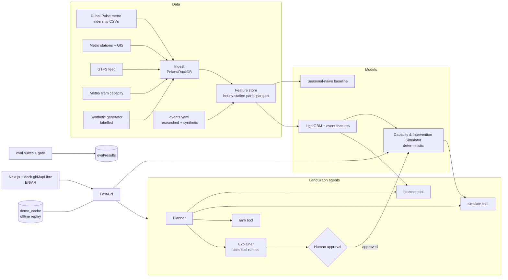

# 03 — Architecture

## Components
| Component | Tech | Responsibility |
|---|---|---|
| Ingest | Polars, DuckDB | Read daily ridership CSVs, normalise station names, aggregate to station × hour entries/exits |
| Features | Polars | Calendar (hour, dow, UAE weekend regime, holiday, Ramadan flag), lags (t-24h, t-168h), event features (distance-weighted, time-to-start/end, attendance bucket) |
| Forecaster | LightGBM (quantile 0.1/0.5/0.9) + seasonal-naive | Hourly entries and exits per station, with intervals |
| Simulator | Pure Python/NumPy | Capacity per hour from headway × train capacity; applies interventions; computes load factor, over-capacity station-hours, peak LF, cost proxy |
| Agents | LangGraph + Anthropic SDK | Plan → call tools → rank → explain; no free-form numbers |
| API | FastAPI | `/healthz`, `/stations`, `/events`, `/forecast`, `/simulate`, `/agent/plan`, `/decisions`, `/evidence` |
| Web | Next.js, deck.gl, MapLibre, Recharts, next-intl | Map, timeline, inspector, scoreboard, evidence, EN/AR |
| Eval | pytest + eval suites | Forecast backtest, simulator invariants, agent faithfulness, red-team, latency |

## API contract (v1)
- `GET /stations` → `[{id, name_en, name_ar, line, lat, lon, capacity_per_train, in_corridor}]`
- `GET /events` → `[{id, name, venue, lat, lon, start, end, attendance, is_synthetic, source_url}]`
- `POST /forecast {event_id|null, date, hours:[0..23], stations:[...]}` → `{run_id, rows:[{station_id, hour, entries_p10,p50,p90, exits_p10,p50,p90}], model, is_synthetic}`
- `POST /simulate {forecast_run_id, interventions:[{type, params}]}` → `{run_id, rows:[{station_id, hour, demand, capacity, load_factor}], summary:{overcap_station_hours, peak_lf, cost_proxy}}`
- `POST /agent/plan {forecast_run_id, goal}` → `{plan_id, options:[{rank, title, interventions, summary_delta, rationale, sources:[run_id...]}]}`
- `POST /decisions {plan_id, option_rank, decision: approve|reject, user}` → logged
- `GET /evidence` → latest eval metrics + data provenance

## Offline mode
`DEMO_MODE=offline`: `/agent/plan` returns cached JSON keyed by (scenario_id, goal hash) from `data/demo_cache/`. Map tiles: use a bundled style with local vector/GeoJSON (no remote tiles), or a pre-rendered basemap PNG under the deck.gl layers.
