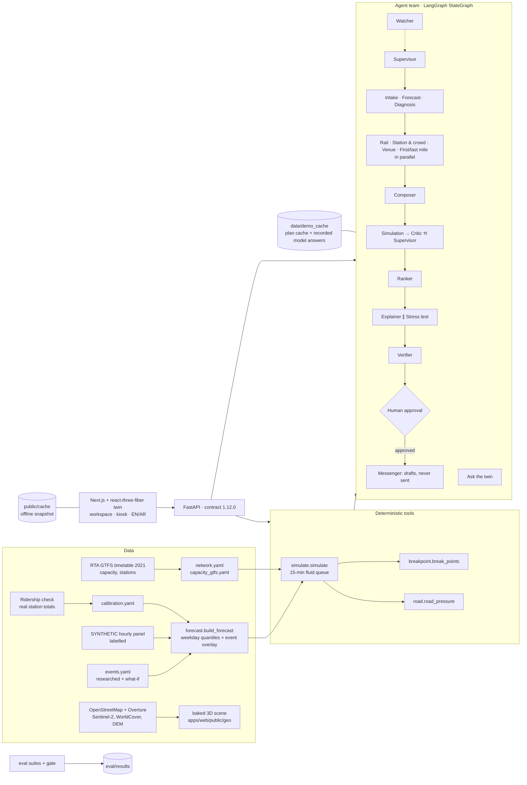

# 03 — Architecture

Updated 16 Nov 2026 to match the code (contract 1.12.0). The agent team is described in depth in
`docs/15_AGENT_ARCHITECTURE.md`; decisions in `docs/09_DECISIONS.md`.

## Components
| Component | Tech | Responsibility |
|---|---|---|
| Forecast | Python, pandas | Same-weekday p10/p50/p90 background + parametric event overlay; what-ifs (attendance, exit window, weather, metro share, real station totals, own event). LightGBM quantile models are backtested (`scripts/baseline.py`), not served |
| Simulator | NumPy | 15-minute bins, GTFS capacity per line and direction, seven typed and bounded interventions, fluid queue (waits), conservation-tested |
| Agent team | LangGraph 1.2 (`agents/engine.py`); same nodes in a plain loop as fallback | 18 agents in 5 layers + 2 standing agents; models only propose, route and explain, code computes and decides (`docs/15`) |
| Language models | OpenAI (GPT-5 family) or Claude, behind one interface (`agents/llm.py`) | Optional: live with `DEMO_MODE=live`; otherwise recorded answers replayed (`agents/personas.py`) or code policies |
| API | FastAPI, Pydantic v2 | Stateless: every run rebuilds from its request spec, so any serverless instance can answer |
| Web | Next.js 16, react-three-fiber, zustand, next-intl | 3D twin on a baked offline scene, workspace (tabs incl. AI team), touch kiosk, EN/AR RTL, offline snapshot fallback |
| Eval | pytest + suites + `eval/gate.py` | forecast, simulator, agents, redteam, orchestration, critic, optimality, safety (all required), latency |

## API (contract 1.12.0, `contract/openapi.json`)
| Endpoint | What |
|---|---|
| `GET /healthz` | ok, contract version, storage, agent engine |
| `GET /stations`, `GET /events` | network and events |
| `POST /forecast` | hourly demand with band; deterministic `run_id` |
| `POST /simulate` | simulation with interventions; summary, hourly rows, road pressure, `source` |
| `POST /breakpoint` | crowd size at which each station crosses the threshold (exact) |
| `POST /agent/run` | **the agent team**: mission with events, objective, constraints, plan, rejected plans, C1–C7 checks, stress tests, budget, recording |
| `GET /agent/roster` | the agents, layers and the orchestration graph (Mermaid, from the compiled graph) |
| `POST /agent/plan` | the plan only (classic single planner; same plans as the team without a model) |
| `POST /watch/scan` · `/agent/message` · `/agent/ask` | standing agents: watcher alerts, messenger drafts, ask the twin |
| `POST /decisions`, `GET /decisions` | human approvals and rejections, append-only audit log |
| `GET /evidence` | newest eval metrics per suite + data provenance |

## Offline mode
The booth runs with no network. `DEMO_MODE=offline`: `/agent/plan` replays `data/demo_cache/plan_*.json`; the agent team
recomputes every simulation and check, and replays recorded model answers from `data/demo_cache/llm/` (or uses code
policies). The web app falls back to `apps/web/public/cache/` (built by `npm run snapshot`) when the API is down, and
says so. The 3D scene, fonts and models are files in the repo.
