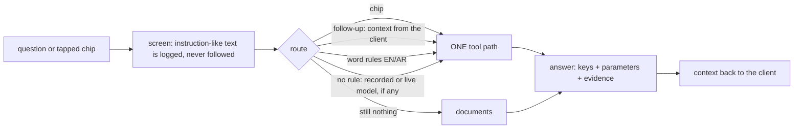

# 18. The assistant: conversation, scenario changes in plain words, cited knowledge, graded confidence

Contract **1.18.0** (assistant 1.17.0, runs 1.18.0) · decisions **#147–#151, #153–#155** · built 18 Nov 2026 · owner of this stream: Krishna.

This is the first slice of the "agentic decision-support" brief of 18 Nov. It adds one conversation engine behind
`POST /agent/chat`, used by the command centre (a new **Ask** tab) and by the kiosk (visitor questions on the rider
screen). It does not replace the agent team (docs/15): it calls it, and only when a question is about plans.

Measured numbers below come from `eval/results/assistant_*.json`. Nothing here needs a language model, a network or
a new package; a recorded or live model can take over the routing of questions the word rules do not recognise.

## 1. Why (what the 18 Nov audit found)

| Gap | Before | Now |
|---|---|---|
| Conversation | "Ask the twin": 8 fixed question types, one shot, no follow-up | 20 planner and 9 visitor intents, multi-turn, follow-ups ("why?", "and Emirates Towers?", "what about 50%?", "undo") |
| Changing the scenario in words | Not possible; the brief box only starts a new mission | "Increase attendance to 60,000, shorten the exit window to 45 minutes" becomes a validated, versioned patch that changes the real scenario |
| Comparing plans on more than relief and cost | One score: riders relieved − λ × cost | Seven objectives, hard constraints first, Pareto set, a lens per question; "not measured" said where true |
| Confidence | A p10–p90 band and "holds in k of n", shown apart | Five graded parts and a weakest-link overall grade; never a percentage |
| Documents | None | 21 passages from 8 sources with authority, URL, dates and licence; hybrid retrieval; "not enough evidence" when nothing fits |
| Kiosk | A fixed tip | Five visitor questions by touch; never any planner function |
| Controls that did not say they were stale | Priority and constraints cleared the plan silently | The assistant tells the planner the plans were cleared and offers the next question |

## 2. How one turn runs

**Least work per question.** The route decides which single path runs:

| Question | What runs | Agents called |
|---|---|---|
| peak time, which station, how busy is X | one simulation | none |
| why is X at risk | simulation + forecast row + break point | none |
| what if attendance / the comfort line changes | one forecast + one simulation (not applied) | none |
| most effective plan, compare, safest, cheapest, fewest resources, confidence | the agent team (one mission, reused while the scenario is unchanged) | the 15 graph agents |
| evidence | forecast run + latest backtest file + three cited passages | none |
| change the scenario | parse → validate → forecast + simulation + break point of the new scenario | none |
| how does X work / what does RTA publish | document retrieval | none |
| kiosk questions | the rider-advice function on one simulation; the network graph; RTA passages | none |

There is no loop in this engine: one question, one path, one answer. The only loop is inside the mission, which
keeps its own budget (docs/15).

**State.** The API keeps no conversation. Every answer returns `context` (session id, turn, the station and hour
the talk is about, the last intent and its arguments, the scenario at the last turn, the one before it, the one to
undo to, session preferences). The client sends it back. Two sessions cannot see each other's context because the
server has none. Nothing is stored after the page closes.

**Audiences.** `audience: "planner"` may use every intent. `audience: "kiosk"` may use only the nine visitor
intents; a planner intent sent as text, as a chip or picked by a model is refused, and the answer never carries a
plan table, a patch, confidence internals or tool runs. With `EVENTFLOW_AUTH=on` the planner audience needs a
signed-in user.

## 3. Changing the scenario in plain words

1. The instruction is split into clauses; each is read for a setting and a value (English and Arabic).
2. Values are checked against `config/assistant.yaml` (`ranges`), which mirrors the sliders, so a control can always
   show the value. Exit window and comfort line are snapped to the sliders' steps.
3. Unclear ("increase attendance"), out of range, or raising the comfort line above 90 % (it hides crowding instead
   of reducing it) → `status: "clarify"` with buttons; nothing is applied.
4. A message that reads like an instruction to the system → `status: "refused"`; nothing is applied.
5. Otherwise the API forecasts and simulates the new scenario and returns `patch`:
   `version` (the client's `scenario_version` + 1), `changes` (`field`, `was`, `to`), the new `forecast` request,
   `threshold`, `priority`, `constraints`, `recalculated` (the forecast, simulation and break-point run ids) and
   `cleared` (`plan`, `mission`).
6. The client makes the patch the shared scenario state (`lib/assistant.ts: applyPatch`). The store then issues its
   usual deterministic requests and arrives at the same run ids. The browser test checks exactly that: store values,
   slider values, version and run id.
7. `undo` (typed, or the button on the latest change) returns the patch back to the scenario before it.

"Prioritise safety" has no control of its own. It is read as the existing priority "most relief", and the answer
says so and points to the safety lens.

## 4. Seven objectives (a view, not a new ranking)

`agents/objectives.py` reads every plan the mission simulated (offered and rejected).

| Objective | Value (lower is better) | Basis |
|---|---|---|
| Safety | peak load | simulator |
| Crowd reduction | riders over the line | simulator |
| Waiting and journey time | longest platform wait | simulator |
| Operational cost | added cost index (a proxy, not dirhams) | simulator |
| Accessibility | extra walking asked of riders (share redirected × minutes' walk) | the plan's own parameters |
| Emissions | — | **not measured**: shown as such, never scored |
| Resource efficiency | operating parties that must act (rail, station staff, venue, buses, robotaxis) | the plan's own parameters |

Order of work: (1) a plan that creates a new hotspot, is worse than doing nothing or breaks a limit the planner set
is removed, whatever its other values; (2) the Pareto set is marked; (3) the rest are ordered by a weighted sum whose
weights are shown. Asking for an unmeasured objective answers `insufficient_evidence` and names the nearest measured
stand-ins. A lens never changes the team's recommendation: the answer says when the two differ and why.

Each row carries a `lifecycle`: `simulated` → `validated` (offered, numbers verified, no hard limit broken) →
`approved` (the planner approved exactly this plan). `executed` is never set: the twin applies plans inside the
simulation only.

## 5. Confidence, in parts

`agents/confidence.py`. No model writes it. Grades are `high`, `medium`, `low` or `unknown`.

| Part | From | Rule |
|---|---|---|
| Forecast | demand band at the hotspot hour; latest backtest file | (p90 − p10) ÷ p50: ≤ 10 % high, ≤ 25 % medium |
| Evidence | where the inputs come from | weakest of demand (synthetic = low), timetable (official, 2021 = medium), attendance and capacity factors (assumptions = low) |
| Robustness | the stress test and the critic's checks | share of stress cases held: ≥ 70 % high, ≥ 40 % medium; a failed hard check = low |
| Validation | the verifier and the simulator's property suite | every number matched and all properties pass = high |
| Execution | budget and stop reason | within budget and goal met = high |

**Overall = the weakest graded part.** With synthetic demand that is `low`, however well a plan tests. The
thresholds are team assumptions in `config/assistant.yaml`.

## 6. Knowledge: documents and the corridor graph

- **Corpus:** `config/knowledge/corpus.yaml`. Each source has `title`, `authority`, `url`, `published`, `retrieved`,
  `licence`, `audiences`; each passage a `section`, text (Arabic draft where a visitor may read it) and a content
  hash. Official pages are summarised in our own words, not copied. To add a source: add it there with all fields
  and re-run `python -m eval.suites.assistant`.
- **Retrieval:** BM25 over words + cosine over character 3–5-grams, fused by reciprocal rank (k = 60). A passage is
  returned only if it shares enough of the question's words; otherwise the answer is "not enough evidence". No
  neural embeddings and no reranker (offline rule, no new package); both are a next step (§9).
- **Scope by audience:** the kiosk sees official and public passages only.
- **Injection:** a passage that matches the intake's instruction patterns is dropped when the corpus loads; passages
  are quoted, never followed.
- **Separation:** documents explain methods and quote authorities. No load, capacity or forecast figure is ever read
  from one.
- **Graph:** 75 nodes and 161 edges built from configuration: stations, lines, events, measures, the specialist that
  proposes each measure and the party that carries it out. Used for "how do I get to X" (stops and line changes),
  walkable neighbours and the parties a plan needs. `GET /knowledge/graph`.

## 7. Contract (for Yash and Atharva)

`contract/openapi.json` is the source of truth; `contract/fixtures/chat_planner_lens.json`,
`chat_planner_edit.json`, `chat_kiosk_accessible.json` and `knowledge_sources.json` are real answers to build against.

- `POST /agent/chat` · `ChatRequest` = the usual scenario reference (`forecast_run_id`, `forecast`, `threshold`,
  `scope`, `applied`) + `message` *or* `intent` (+ `args`), `audience`, `locale`, `priority`, `constraints`,
  `station`, `hour`, `scenario_version`, `context`.
- `ChatResponse`: `status` (`answered` | `applied` | `clarify` | `refused` | `insufficient_evidence`), `blocks`
  (`key` + `params`; the client words them), `evidence`, `passages`, `table`, `confidence`, `patch`, `options`
  (buttons: `label_key`, `params`, `intent`, `args`), `suggestions`, `routed_by`, `tools`, `findings`, `context`.
- Parameter names say what they hold: `_st` station id, `_pct` percentage, `_n` count, `_x` decimal, `_t` time,
  `_s` text, `_list` station ids. One formatter (`components/assistant/say.ts`) serves every answer.
- Errors: 422 for a malformed or oversized request (message over 500 characters, more than 16 arguments); 401/403
  for the planner audience with auth on; a question that cannot be answered is a 200 with `refused` or
  `insufficient_evidence`, never an error.
- `GET /knowledge/sources`, `GET /knowledge/graph`.
- The simulator is called only through `run_simulation` and `build_from_spec`; nothing in Atharva's files changed.
  `POST /agent/ask` (the old Ask) is unchanged.

## 8. What changed on screen

| Where | Change |
|---|---|
| Workspace, new **Ask** tab | Conversation with the twin: typed questions and tappable chips; follow-ups; scenario version badge; SYNTHETIC badge |
| Ask tab, every answer | "Behind this answer" (simulator, forecast, break-point and mission run ids; document cards with authority, dates, licence); how it was routed; what ran |
| Ask tab, scenario change | Green "Scenario changed" card with each setting before → after, the recalculated runs, and **Undo this change**; the sliders on the left move |
| Ask tab, unclear instruction | "I need one more thing" with value buttons; a warning before raising the comfort line above 90 % |
| Ask tab, plans | A card per plan with six measured values and "Emissions: not measured"; badges for the team's recommendation, offered / tested only, Pareto; "Order by" lens chips |
| Ask tab, recommendation | "Confidence, in parts": five graded rows and the overall grade with what holds it back |
| Kiosk, "I'm travelling" | **Ask about your trip**: five questions by touch (which station, when to leave, step-free access, other stations nearby, how to reach a station); RTA's page quoted with its source; no keyboard |
| AI plan tab | Run bar (status, scenario version, Cancel, Run again, stale-scenario warning), **Auto-run** switch, **Compare these plans on seven objectives**, **Run history** with Compare with now and Restore this scenario (§13) |
| Both | English and Arabic (drafts for the native reviewer, issue #43) |

## 9. Measured (18 Nov 2026, word rules only, no model)

| Metric | Value | Note |
|---|---|---|
| Routing, questions seen while writing the rules | 28 of 28 | in-sample |
| Routing, held-out phrasings | 17 of 24 (0.71) | the honest figure for word rules; a model router is the fix |
| Scenario edits, dev / held-out | 9 of 9 / 3 of 4 | |
| Patch run = the run `/forecast` gives | 12 of 12 | |
| Unclear or unsafe instruction asked back | 5 of 6 | the sixth was refused, not applied |
| Instruction-like message changed the scenario | 0 of 4 | |
| Kiosk leaked planner material | 0 of 36 turns | |
| Retrieval recall@3, dev / held-out | 8 of 8 / 8 of 8 | small corpus |
| Out-of-corpus question answered | 0 of 6 | one held-out failure led to the "other transport modes" rule and was moved to dev |
| Answers with a run or document behind them | 100 % | |

## 10. Not done, and buildable next

1. **A model router** for unseen phrasings (recorded for the booth). Needs the OpenAI key in `.env`; the hook
   (`personas.ask_route_model`) and its test exist.
2. **Model-written explanations** over the same evidence, with the verifier checking every number.
3. **Neural embeddings and a reranker** for retrieval, measured against today's baseline on the same gold set.
4. ~~Run registry, run history, auto-run~~: built the same day, see §13. Still open there: history that survives a
   reload, and a server-side cancel for long model runs.
5. **Objectives inside the ranking** (today they are a view), and an emissions model.
6. **Station-level accessibility data** (lift status). The twin has none; RTA's page is network-level.
7. **Typed graph state and a checkpointer** for the mission, replacing replay-based pauses.
8. **Conformal intervals** on real ridership once it is ingested.

## 11. Ownership note

The 18 Nov brief names Krishna as owner of orchestration, conversation, retrieval and contracts, Atharva of the
simulator and Yash of the front end. `docs/TEAM_PLAN.md` (11 Nov) says A = Krishna (data), B = Atharva (agents),
C = Yash (front end). This slice follows the 18 Nov brief. Files touched outside the stream, kept minimal:
`components/Panel.tsx` (one tab), `components/kiosk/Kiosk.tsx` (one line), `lib/store.ts` (the tab's name),
`lib/api.ts`, `lib/requests.ts`, both message files and the two style sheets (appended blocks).

## 12. Sources read for the design (18 Nov 2026)

- LangGraph in production (typed state, checkpointers, `interrupt()`): [production checklist](https://www.diagrid.io/blog/langgraph-agent-production-checklist), [state and checkpoints](https://eastondev.com/blog/en/posts/ai/20260424-langgraph-agent-architecture/), [interrupt pitfalls](https://hackernoon.com/agent-graph-engineering-part-7-why-langgraph-interrupt-can-fail-silently-in-production)
- Routing cheaply before a model: [intent classification layer](https://tianpan.co/blog/2026-04-16-intent-classification-agent-routers), [rule → semantic → LLM cascade](https://blog.meganova.ai/the-3-tier-routing-cascade-rule-based-semantic-llm/)
- Hybrid retrieval: [benchmark, BM25 + dense + reranking](https://arxiv.org/pdf/2604.01733), [BM25 in production](https://tianpan.co/blog/2026-04-12-hybrid-search-production-bm25-dense-embeddings), [static embeddings trade-off](https://qdrant.tech/articles/embedding-at-the-speed-of-light/)
- Natural-language filters: [session-scoped dashboard agent](https://docs.cube.dev/docs/explore-analyze/dashboards/dashboard-agent.md), [clarification loops, NOVAID](https://ojs.aaai.org/index.php/AAAI/article/view/41475/45436)
- Multi-objective planning in transport: [ε-constraint method](https://repository.tudelft.nl/record/uuid:e64cbda6-5232-446a-983b-102a2f15bf87), [decision support on a Pareto front](https://napier-repository.worktribe.com/OutputFile/860056)
- Confidence in interfaces: [citations and verbalised uncertainty](https://xai.kaist.ac.kr/static/files/2025_hcai_workshop/paper_29.pdf), [confident wrong answers](https://mspk.substack.com/p/designing-for-confident-wrong-answers)
- Conformal prediction for demand: [StatsForecast tutorial](https://nixtlaverse.nixtla.io/statsforecast/docs/tutorials/conformalprediction.html), [traffic demand intervals](https://arxiv.org/pdf/2504.13961)
- Kiosk conversation design: [suggestion chips](https://developers.google.com/assistant/conversation-design/suggestions), [never a dead end](https://developers.google.com/business-communications/business-messages/guides/how-to/design/happy-path)
- Accessibility facts: [RTA, People of Determination](https://www.rta.ae/wps/portal/rta/ae/home/people-of-determination), [RTA, 82 % of facilities retrofitted](https://rta.ae/wps/portal/rta/ae/home/news-and-media/all-news/NewsDetails/82-percent-of-facilities-retrofitted-for-people-of-determination)

## 13. Runs: status, auto-run, cancel, history, scenario comparison (contract 1.18.0, decision #153)

**On screen (AI plan tab).**
- **Run bar** under the Plan button: what the latest run is doing, for which scenario version and who started it;
  **Cancel this run**; **Run again**; a warning when the scenario has changed since the last analysis.
- **Auto-run** switch: the team runs by itself whenever the scenario changes, by hand, through the assistant or by
  restoring a past run. Several quick changes are one run, for the latest scenario. Off by default. Nothing is applied
  without an approval, as before.
- **Compare these plans on seven objectives**, under the options: the same table the Ask tab gives.
- **Run history**: this session's runs, newest first, each with its status, scenario version, trigger, time taken,
  what it recommended and its mission id; **Compare with now** and **Restore this scenario**.

**Statuses** (`apps/web/src/lib/runs.ts`):

| Status | Meaning |
|---|---|
| queued | an automatic run waits for the scenario's forecast and simulation |
| running | the team is working |
| paused | the team asked the planner a question (a checkpoint) |
| completed | a plan, or "no plan needed", is on screen |
| failed | the planning service did not answer |
| cancelled | the planner stopped it; its answer is dropped if it still arrives |
| superseded | the scenario changed while it ran; its answer is for an old scenario and is dropped |

**Why the ledger is in the page and not in the API.** The API is stateless (any instance serves any request, the
hosted store is per instance) and a mission without a model takes under two seconds, so there is nothing for a server
to queue or cancel. The page follows the store's plan status and records what happened. What makes this safe is
already in the store: an answer whose run is no longer current is dropped. Runs are deterministic, so running the same
scenario twice gives the same run ids; asking twice is harmless (the browser test checks the mission id is the same).
When recorded or live model runs make a mission long, a server-side run with a cancel is the next step.

**`POST /scenario/compare`.** Two scenarios (`a`, `b`: forecast request, comfort line, priority, constraints) →
the settings that differ, peak load and over-threshold time before any plan for each, the team's recommendation for
each (or none), whether it is the same plan, and every run id. Both sides are forecast, simulated and planned in the
call. Fixture: `contract/fixtures/scenario_compare.json`.

**Restore** makes a past run's scenario the scenario on screen through the same path as an assistant patch
(`lib/assistant.ts: applySettings`), as a new version. An incident is left as it is: it belongs to the duty view.

**Checked** (`apps/web/tests/runs.spec.ts`, `tests/test_assistant.py`): the status shown is what happened; auto-run
starts by itself and only for the latest scenario; a superseded or cancelled run's answer never reaches the screen;
the plan on screen is always for the forecast on screen; compare matches each side's own runs; restore moves the real
controls.

## 14. The team asks by default; a calm day gets a question, not silence (decision #154)

Before: "Ask me during planning" could be ticked and the team still said nothing, because with no station over the
comfort line the run ended before any checkpoint. Now there are three checkpoints:

| Checkpoint | When | What the human is offered |
|---|---|---|
| `hotspot` | a station is over the line | plan for it, plan for another station, or leave it |
| `partial` | the best plan still leaves riders over the line | accept, raise the cap, or allow a measure that was held back |
| `calm` (new) | nothing is over the line | up to three harder scenarios the team already tested (break-point crowd, hot day, stricter line), or "leave it" |

Each `calm` probe is a real forecast and simulation (its `run_id` is in the pause). Choosing one changes the scenario
on screen and the team runs again for it. Asking is on by default in the workspace and on the kiosk; `?ask=0` turns it
off, and the guided demo and the 60-second kiosk show never wait.

## 15. The kiosk: type or tap, suggestions, plan editing, filters, preferences (decision #155)

| On the kiosk | Where | What happens |
|---|---|---|
| **✦ Ask the AI** (top bar) | planner screens | opens with scenarios the AI already tested; a tap makes one the scenario; **Type** opens the built-in keyboard (EN/AR) with suggested phrases; **Undo last change** |
| **Describe a new event** | the same sheet | words → what was understood → confirm → the team plans (and asks, if asking is on) |
| **Ask the AI team anyway** | "See the crowd", when nothing is over the line | the team tests harder and asks the visitor (section 14) |
| **Rules** tab | stress test | weather, comfort line, exit window, what the team favours |
| **✎ Edit** on a plan | the plans | change a setting or remove a measure; simulated before approval; "Approve my version" is logged |
| **✦ Ask the AI** | "I'm travelling" | questions by tap or typing; step-free, room and short walk change the answer and are said |

Audiences of `POST /agent/chat`: `planner` (everything), `sandbox` (the kiosk's planning game: scenario changes and
what-ifs, no internals), `kiosk` (visitor answers only). Limits: the keyboard has no upper case or diacritics; typed
Arabic is routed by word rules with the same held-out accuracy caveat as section 9; the QR handoff and voice are not built.

