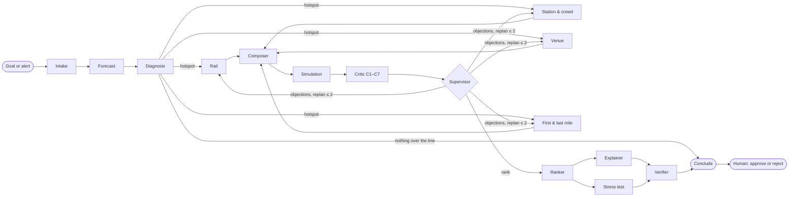
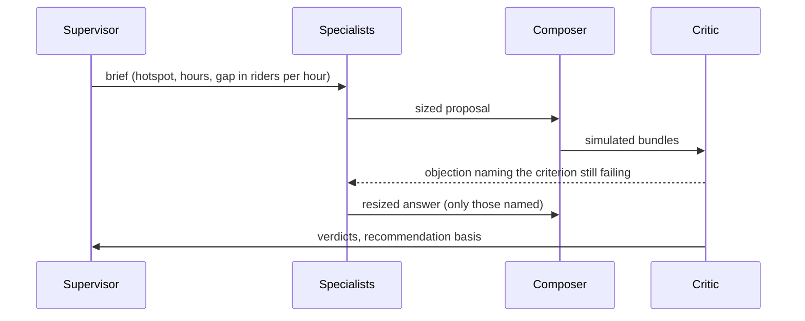
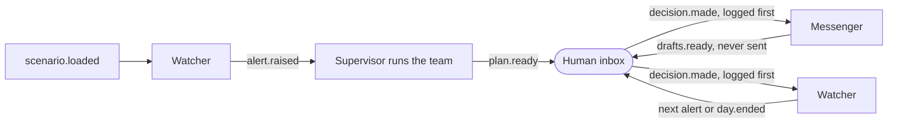

# Agentic architecture

A summary with diagrams for the nomination and the jury. The full description, with every rule the agents act on,
is `docs/15_AGENT_ARCHITECTURE.md`; the generated graph is served by `GET /agent/roster`.

## 1. The brief's agent roles, mapped to the agents that exist

| Role asked for | Agent(s) in the code | Kind |
|---|---|---|
| Master orchestrator | **Supervisor** (`agents/nodes.py`): routes between layers, enforces the budget (60 steps, 80 simulations, 12 model calls, 45 s), decides replan, stop or hand to the human | code |
| Planning and reasoning | **Composer** (bundles, ordering, replan variants) and the Supervisor's replan edge | code |
| Domain intelligence | **Diagnosis** (hotspot, hours, quietest neighbour, shuttle target), **Watcher** (looks 3 h ahead) | code |
| Data intelligence | **Intake** (goal and typed constraints, screens free text for injection), **Forecast** | model + code |
| Execution | **Rail**, **Station & crowd**, **Venue**, **First & last mile** specialists size their own measures; **Simulation** runs every bundle; **Messenger** drafts notices | model + code |
| Evaluation and quality | **Critic** (C1–C7, objections), **Stress test**, **Ranker**, **Verifier** (every number must be a tool's) | code |
| Communication | **Explainer** (EN + AR), **Ask the twin** (one tool per question, refuses off-topic) | model + code |
| Memory and learning | session state, chain state and the decision log exist; **a Memory agent that uses past decisions does not yet** (roadmap M2) | — |

18 agents in five layers plus two standing agents; 8 may call a language model, 10 are code. The human is the last
step, and nothing is applied without the human.

## 2. One mission (LangGraph `StateGraph`)

The four specialists run in parallel and the Composer waits for all of them. Parallel agents never write shared
state; the next agent merges their results in roster order, so the graph and the sequential fallback engine produce
identical events (`engines_agree` 1.0, `orchestration_20261116-204754.json`).

## 3. Agents that talk to each other

Measured: 12 objections raised, 12 answered (`objections_answered` 1.0, same file).

## 4. The event chain (agents triggered by each other's events)

`agents/chain.py`; `POST /chain/start`, `POST /chain/{id}/decide`. The chain's whole state is one JSON document in the
store, so any API instance can continue it.

## 5. Tools, state, memory, failure handling

| Concern | How |
|---|---|
| Tool interfaces | Python functions with typed inputs: `forecast.build_forecast`, `simulate.simulate`, `breakpoint.break_points`, `road.road_pressure`; every call returns a run id that travels with the figure |
| Structured outputs | Pydantic models; model answers must match a JSON schema, anything outside the specialist's measures or the bounds in `config/corridor.yaml` is dropped before simulation |
| Shared context | the mission state passed along the graph; events carry `agent`, `to`, `key`, `params` |
| Persistent state | chains, users, sessions in SQLite (offline) or Postgres; decision log append-only with `prev`/`hash` (`GET /decisions/verify`) |
| Memory | within a mission and a chain: yes. Across missions: not yet (roadmap M2) |
| Retries | model calls retry twice with a timeout (`agents/llm.py`); a failed or invalid model answer falls back to the agent's code policy |
| Failure recovery | LangGraph missing → same agents in sequence; API down → the offline snapshot replays recorded missions; budget reached → the Supervisor stops and hands over what it has |
| Completion check | Critic C1–C3 decide "goal met"; the Verifier blocks any text figure that is not a tool's; the shift ends "clear" only if nothing is over the line |
| Observability | live stream `POST /agent/run/stream`, one span per agent step, optional OpenTelemetry export |

## 6. Safety boundary

The twin controls nothing in the real world. Every action is a simulated measure; the only real effect is a logged
decision and, in product mode, a published notice that a person approved and pressed publish. Free text never changes
a simulation: constraints come only from typed controls.
