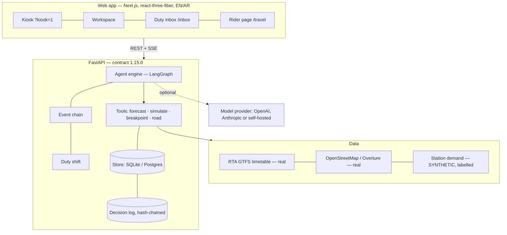

# Technical documentation

Entry point for engineers and the jury. It points to the detailed documents instead of repeating them.

## 1. System components



## 2. Stack and why

| Layer | Choice | Reason |
|---|---|---|
| Agents | LangGraph `StateGraph` (+ identical sequential fallback) | conditional edges, fan-out/fan-in, budget as recursion limit; no LangChain needed |
| API | FastAPI + Pydantic v2 | typed contract exported to TypeScript, one source of truth |
| Models | OpenAI, Anthropic or an OpenAI-compatible self-hosted server (`agents/llm.py`) | provider interface; booth replays recorded answers offline |
| Data | Polars, DuckDB, LightGBM (backtest), statsmodels | fast local processing, no server |
| Store | SQLite offline, Postgres with `DATABASE_URL` | the booth needs no database server |
| Live updates | server-sent events (`POST /agent/run/stream`) | one-way stream is enough; no WebSocket server to run |
| Web | Next.js App Router, react-three-fiber, zustand, next-intl | 3D twin, RTL Arabic, offline snapshot |
| Document retrieval (since 18 Nov, #150) | BM25 + character n-gram vectors in plain Python, reciprocal rank fusion | a 21-passage cited corpus; offline, no new package; explanations and published facts only, never figures |
| Not used, on purpose | a vector database, neural embeddings, Redis | the corpus is small and the booth is offline; state is small and fits the store |

## 3. Data sources

| Data | Status | Where |
|---|---|---|
| Metro timetable and capacity | real: RTA GTFS | `docs/04_DATA_SOURCES.md` |
| 3D city | real: OpenStreetMap, Overture, Copernicus, ESA WorldCover | `docs/metrics.md` |
| Station demand | **synthetic**, labelled `is_synthetic=true` and on screen | `scripts/synth.py` |
| RTA ridership | read (10.48 M rows) but no time of day, so not usable hourly | `docs/14_RIDERSHIP_DATA.md` |
| Event attendance, metro share, incident effects | assumptions, editable, labelled | `config/*.yaml` |

## 4. Running it

```bash
python tasks.py demo
```

That starts the booth mode: offline agent cache, then the API and the production web app. Other commands are in
`CLAUDE.md` and `docs/BOOTH_RUNBOOK.md`. Docker: `docker compose up`.

## 5. Security and privacy

- No personal data: station aggregates only; kiosk counters are anonymous and stay in the browser.
- Keys only from the environment, never in the repository; the booth runs with no key at all.
- Free text is data: goals, notes and questions are screened for injection and never become constraints.
- Decision log is append-only and tamper-evident (`GET /decisions/verify`).
- Optional sign-in with roles (viewer < planner < admin), off by default at the booth.
- The API image runs with `--network none` in CI.

## 6. Limits and readiness

Prototype, lab-validated on synthetic demand and the real timetable. Not connected to any RTA system and controls
nothing in the real world. Limits are listed in `docs/15_AGENT_ARCHITECTURE.md` §7.
